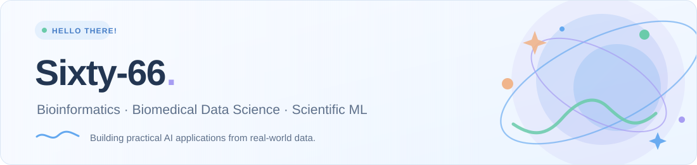

<picture>
  <source media="(max-width: 620px) and (prefers-color-scheme: dark)" srcset="./assets/hello-mobile-dark.svg">
  <source media="(max-width: 620px) and (prefers-color-scheme: light)" srcset="./assets/hello-mobile-light.svg">
  <source media="(prefers-color-scheme: dark)" srcset="./assets/hello-dark.svg">
  <source media="(prefers-color-scheme: light)" srcset="./assets/hello-light.svg">
  
</picture>

Hi, I'm 66! 👋

### 🧪 What I work on

- **AI for Science** — scientific ML, materials and process modeling, and experiment design.
- **Applied ML & Data Analysis** — data analysis, AutoML, model evaluation, and reproducible pipelines.
- **Deep Learning & Computer Vision** — neural networks, image recognition, and medical image segmentation.
- **Computational Biology** — genomics, biomedical data, and scientific workflows.

**Usually coding with:** `Python` `PyTorch` `scikit-learn` `pandas` `SQL` `R` `Git`

### 🌿 A little about me

I studied **Bioengineering at Southeast University (B.Eng.)** and **Biomedical Engineering at Columbia University (M.S.)**. I started out working with genomic data, and I still enjoy the mix of biology and coding.

### 🌱 What I'm Exploring

I'm always exploring projects in **AI for Science, LLM-powered apps, and computer vision**.

I've also contributed to a few open-source projects, including:

[**Mol\***](https://github.com/molstar/molstar) · [**nnU-Net**](https://github.com/MIC-DKFZ/nnUNet) · [**ToolUniverse**](https://github.com/mims-harvard/ToolUniverse) · [**SeqKit**](https://github.com/shenwei356/seqkit) · [**polars-bio**](https://github.com/biodatageeks/polars-bio) ……

### ✍️ Notes & writing

Sometimes I share what I've learned on [**CSDN**](https://blog.csdn.net/Pu847044653).

---

Thanks for stopping by! ☕
